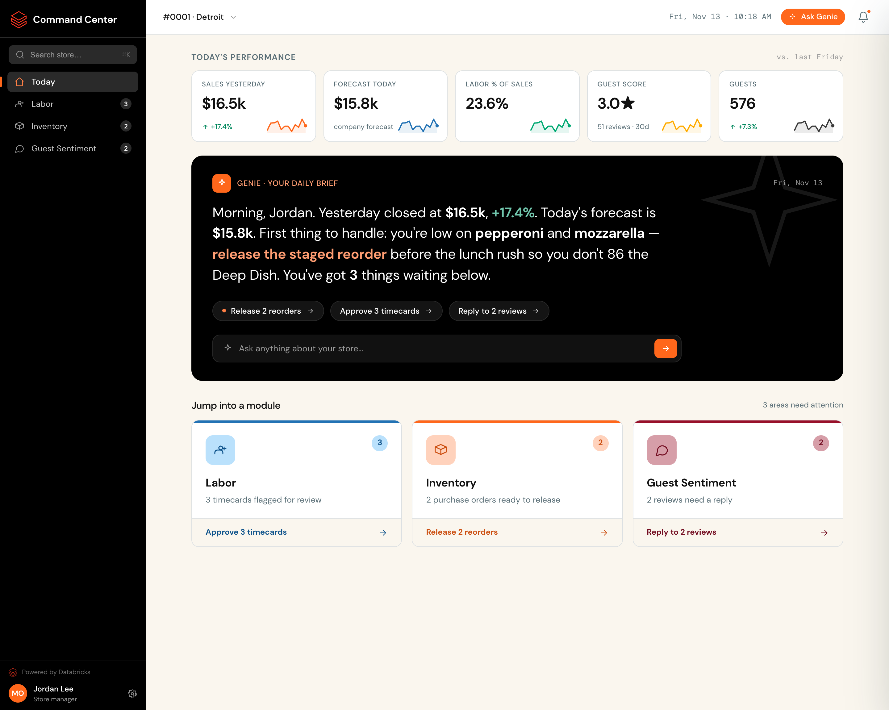
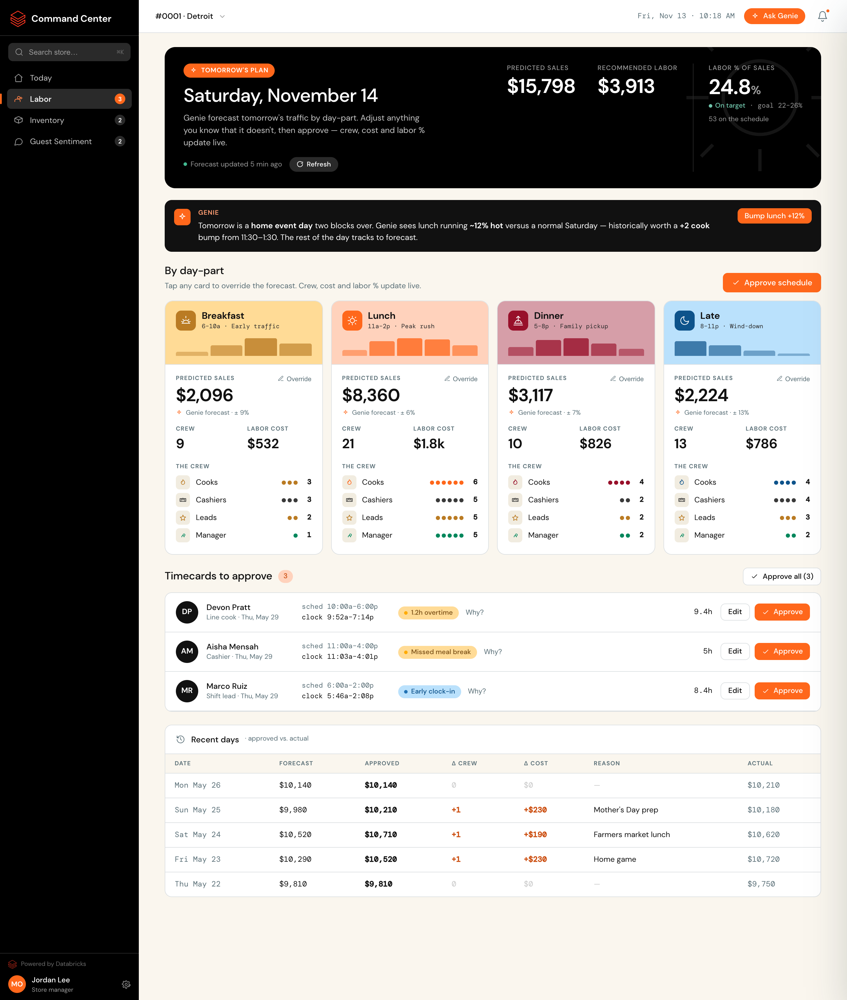
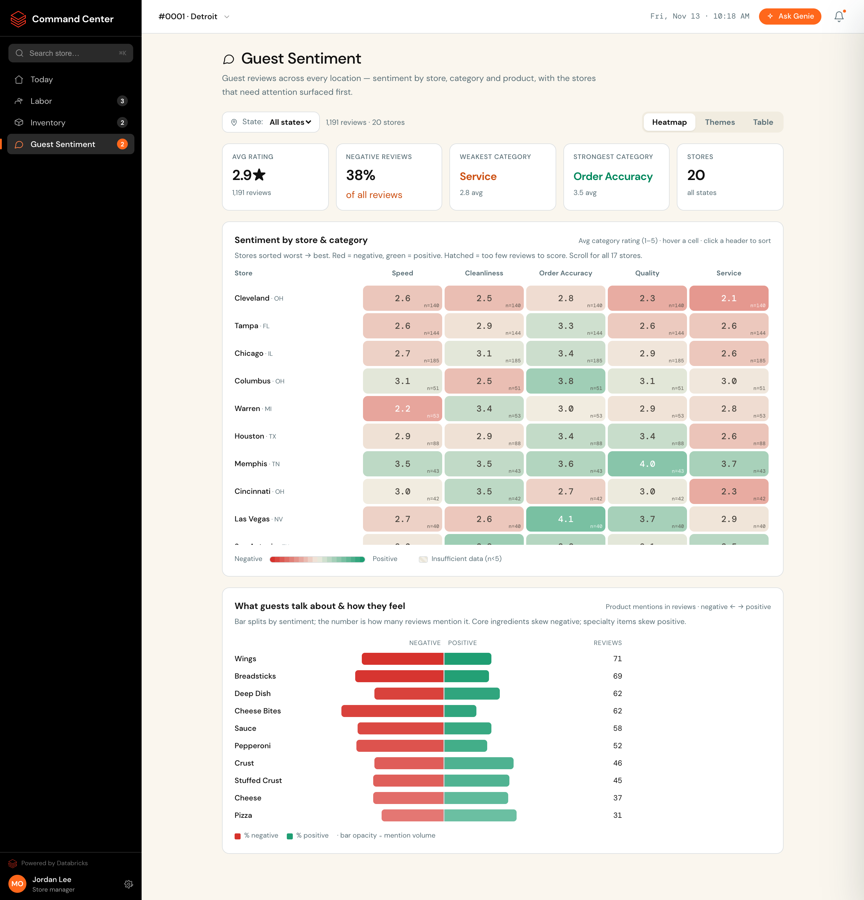
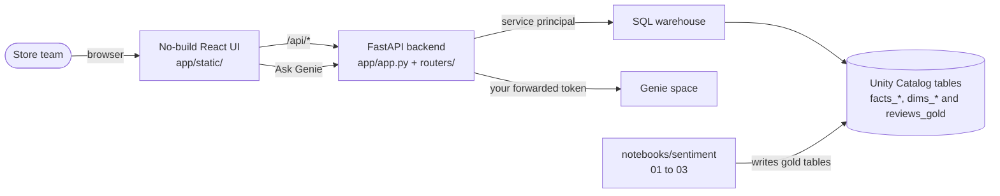

<div align="center">


# QSR Command Center

**One operational cockpit for a quick-service restaurant brand, built on governed Lakehouse data.**

[](https://docs.databricks.com/aws/en/dev-tools/databricks-apps/)
[](https://docs.databricks.com/aws/en/dev-tools/bundles/)
[](https://docs.databricks.com/aws/en/genie/)
[](https://docs.databricks.com/aws/en/data-governance/unity-catalog/)
[](https://fastapi.tiangolo.com/)
[](https://react.dev/)

</div>

<p align="center">
  
</p>

---

## ✨ What it does

| | Feature | What you get |
|---|---|---|
| 🏠 | **Today** | A Genie-first home with headline KPIs for one store, as of the anchor date, and an "Ask anything" bar. |
| 👥 | **Labor** | Tomorrow's daypart staffing plan, with timecards to approve and recent forecast against actuals. |
| 📦 | **Inventory** | Stock health, fill by category, watched items, and open purchase orders. |
| 💬 | **Guest Sentiment** | Sentiment by store and category, product mentions, theme clusters, sentiment over time, and review detail. |
| ✨ | **Ask Genie** | Natural-language questions over a Genie space, answered in a slide-over panel. |
| 🔐 | **Runs as you for Ask** | Ask forwards your Databricks token to Genie, so Genie applies your own permissions. Other reads use the app's service principal. |

<table>
  <tr>
    <td width="50%"></td>
    <td width="50%"></td>
  </tr>
  <tr>
    <td align="center"><sub>Labor: tomorrow's daypart plan, crew, and timecards to approve</sub></td>
    <td align="center"><sub>Guest Sentiment: sentiment by store and category, and product mentions</sub></td>
  </tr>
</table>

## 🏗️ How it works



- **Reads** go through the app's service principal and a SQL warehouse. The bundle grants that principal `CAN_USE` on the warehouse and `SELECT` on the Guest Sentiment table.
- **Ask** uses the `X-Forwarded-Access-Token` that Databricks Apps sends with each request, so the answer respects your access to the Genie space. Without that header, Ask returns a "missing OBO context" error.
- **Config** is read from `app/app.yaml` (`CC_*` variables), or from `/Workspace/Shared/command-center/config.json` when that file exists. The file wins over the environment variables. Set `CC_CONFIG_PATH` to an empty value to skip the file.

## 🚀 Quick start

> [!NOTE]
> The repo ships no customer data. The data is synthetic and the brand is fictional. Generate the Guest Sentiment table with the notebooks in `notebooks/sentiment/`, and load or generate the operational tables (`facts_*`, `dims_*`) in a catalog you can read. The defaults point at `jdub_demo`, which is a demo catalog, so change them to your own catalog and schema.

**Choose your path:**

| | Path | You need | Best for |
|---|---|---|---|
| 💻 | **Option A: run from your laptop** | Databricks CLI, Python 3.11+ | Development, and checking data before a deploy |
| 📦 | **Option B: Declarative Automation Bundles (DABs)** | Databricks CLI | Repeatable deploys into a Databricks workspace |

### 💻 Option A: run from your laptop

1. **Clone** the repo.
   ```bash
   git clone https://github.com/jonathan-whiteley/qsr-command-center-demo.git qsr-command-center
   cd qsr-command-center/app
   ```
2. **Install** the app dependencies in a virtual environment.
   ```bash
   python3 -m venv .venv && source .venv/bin/activate
   pip install -r requirements.txt
   ```
3. **Sign in** to the workspace that holds your data (one time).
   ```bash
   databricks auth login --host https://<your-workspace-url> --profile <profile>
   ```
4. **Start** the server with the profile, host, and warehouse set. A local run does not get the App runtime variables, so set them yourself. `CC_CONFIG_PATH=` skips the workspace config file, so the local run uses the variables in `app/app.yaml` only.
   ```bash
   export DATABRICKS_CONFIG_PROFILE=<profile> DATABRICKS_HOST=https://<your-workspace-url> DATABRICKS_WAREHOUSE_ID=<warehouse-id> CC_CONFIG_PATH=
   uvicorn app:app --reload --port 8000
   ```
5. **Open** http://localhost:8000. The root path redirects to `Home.html`.

The UI loads React and Babel from unpkg.com, so the browser needs internet access. Ask returns an error locally, because a local run has no forwarded user token. Use an app deployment to test Ask. The other modules read the same tables as the deployed app.

### 📦 Option B: Declarative Automation Bundles (DABs)

Add `--profile <profile>` to each command if you have more than one Databricks profile.

1. **Validate** the bundle.
   ```bash
   databricks bundle validate -t dev --profile <profile>
   ```
2. **Deploy** the app source and create or update the app.
   ```bash
   databricks bundle deploy -t dev --profile <profile>
   ```
3. **Start** the app. A bare `deploy` leaves it stopped.
   ```bash
   databricks bundle run qsr_command_center_app -t dev --profile <profile>
   ```

> [!WARNING]
> **Adopting an existing app.** The app name is fixed to `qsr-command-center-demo` in `resources/app.yml`. If an app with that name already exists in the target workspace, `bundle deploy` updates that app in place. To deploy a second copy, change `name` in `resources/app.yml` first. Renaming the app later creates a new app with a new service principal and URL.

To remove the app, run `databricks bundle destroy -t dev --profile <profile>`. This does not remove the grants the bundle made, so revoke them yourself if you no longer need them.

> [!NOTE]
> **Built UI is not compiled.** The UI is plain JSX loaded in the browser, so there is no build step. Edit files in `app/static/` and redeploy.

### 🧬 Optional: generate the Guest Sentiment table

The notebooks in `notebooks/sentiment/` build the table that the Guest Sentiment tab and Ask read. They generate **synthetic reviews** for a fictional brand, so no external API or key is needed. Run them as a Job, in order, on serverless compute.

1. **Run** `01_ingest_clean`. It generates reviews and writes `reviews_bronze`, `reviews_silver`, and a small `store_locations` table under the `catalog` and `schema` widgets. The defaults are `jdub_demo.guest_sentiment`. Set `n_reviews` and `seed` to change the volume or make a different sample.
2. **Run** `02_enrich`. It makes one `ai_query` call per review and writes `reviews_gold`. The `model` widget defaults to `databricks-gpt-oss-20b`. It joins `store_locations` to build the "City, ST" store labels.
3. **Run** `03_genie_agent`. It creates a Genie space over the gold table and prints the space ID. The `warehouse_id` widget has **no default**, so set it to a SQL warehouse you can use.
4. **Optional:** set `GENIE_SPACE_ID` in `app/app.yaml` to the printed space ID, then redeploy. Without it, the app searches for a space titled `QSR Guest Reviews`, which is the title notebook 03 gives the space.

Notebook 01 writes only to the schema you name. It does not call any external service.

## 🔧 Deploy to your own workspace

> [!IMPORTANT]
> **The settings that matter live in two files.** `app/app.yaml` holds the table names the app reads. `databricks.yml` holds the warehouse and the grant targets. Keep the two in sync: the bundle grants `SELECT` on the table named by its variables, and the app reads the table named in `app/app.yaml`.

| Setting | File | What to set | Default |
|---|---|---|---|
| `CC_CATALOG`, `CC_SCHEMA` | `app/app.yaml` | Catalog and schema for the operational tables (`facts_*`, `dims_*`) | `jdub_demo`, `qsr_ops_demo` |
| `CC_SENTIMENT_CATALOG`, `CC_SENTIMENT_SCHEMA`, `CC_SENTIMENT_TABLE` | `app/app.yaml` | Guest Sentiment table (notebook 02 output) | `jdub_demo`, `guest_sentiment`, `reviews_gold` |
| `ANCHOR_DATE` | `app/app.yaml` | As-of date that Today, Labor, and Guest Sentiment queries use | `2026-06-22` |
| `GENIE_SPACE_ID` | `app/app.yaml` | Genie space for Ask. Empty means search by title | empty |
| `GENIE_TITLE` | Environment only (not in `app/app.yaml`) | Title to search for when `GENIE_SPACE_ID` is empty | `QSR Guest Reviews` |
| `CC_CONFIG_PATH` | Environment only | Workspace config file to read. Empty skips it (local runs) | `/Workspace/Shared/command-center/config.json` |
| `FMAPI_ENDPOINT` | `app/app.yaml` | Model endpoint shown in the connectivity banner. The app does not call it | `databricks-claude-sonnet-4-6` |
| `warehouse_id` | `databricks.yml` (`--var`) | SQL warehouse the app uses | lookup: `Serverless Starter Warehouse` |
| `sentiment_catalog`, `sentiment_schema`, `sentiment_table` | `databricks.yml` (`--var`) | Table that the bundle grants `SELECT` on | `jdub_demo`, `guest_sentiment`, `reviews_gold` |
| `warehouse_id` (notebook 03) | Notebook widget | SQL warehouse for the Genie space | none. Required |

To point a DAB deploy at your own warehouse and sentiment table:

```bash
databricks bundle deploy -t dev --profile <profile> \
  --var warehouse_id=<warehouse-id> \
  --var sentiment_catalog=<catalog> \
  --var sentiment_schema=<schema> \
  --var sentiment_table=<table>
```

Pass the same `--var` values to `bundle run` and `bundle destroy`. The `cc_catalog` and `cc_schema` variables in `databricks.yml` are not used by the app. Change the `CC_*` values in `app/app.yaml` instead.

### Privileges

| Who | Needs | Why |
|---|---|---|
| **You** (the person deploying) | Permission to create apps, `CAN_USE` on the warehouse, and ownership or `MANAGE` on the sentiment table | The bundle creates the app and grants `SELECT` on the sentiment table to the app's service principal |
| **The app's service principal** (created with the app) | `CAN_USE` on the warehouse and `SELECT` on the sentiment table (both granted by the bundle) | Runs every read except Ask |
| **The app's service principal** | `USE CATALOG`, `USE SCHEMA`, and `SELECT` on the operational tables | **Not granted by the bundle.** Grant these by hand for `CC_CATALOG` and `CC_SCHEMA` |
| **Every user of the app** | Access to the app, and `CAN_VIEW` on the Genie space | Ask runs with the user's token. The app requests the `genie`, `sql`, and `dashboards.genie` scopes |

> [!TIP]
> **Can't grant on your schema?** Ask the schema owner to run the grants for the service principal, using the app's service principal name from `databricks apps get qsr-command-center-demo`.

## 📁 Project structure

```
.
├── app/                    Databricks App: FastAPI backend and no-build React UI
│   ├── app.py              entry point: mounts the routers and serves static/
│   ├── app.yaml            run command and env defaults (edit CC_* here)
│   ├── routers/            one router per module (today, labor, inventory, feedback, genie)
│   ├── lib/                settings, warehouse client, and SQL helpers
│   └── static/             Home.html and the JSX views in static/app/
├── databricks.yml          bundle name, variables, and dev/prod targets
├── resources/app.yml       the app resource: warehouse and table grants, user scopes
├── notebooks/sentiment/    synthetic review pipeline: 01 generate, 02 enrich, 03 Genie space
└── docs/images/            README screenshots
```

## 🩺 Troubleshooting

| Symptom | Fix |
|---|---|
| Ask shows **`missing OBO context`** | Ask needs the forwarded token that only the App runtime sends. A local run cannot provide it. Test Ask in a deployed app. |
| Ask shows **`no matching space`** or **`no Genie space resolved`** | Set `GENIE_SPACE_ID` in `app/app.yaml` to the space ID from notebook 03, or rename the space to match `GENIE_TITLE` (default `QSR Guest Reviews`). |
| A module is **empty or errors**, with data expected | Check that `CC_CATALOG`, `CC_SCHEMA`, and the sentiment variables in `app/app.yaml` name tables that exist. Grant the app's service principal `USE CATALOG`, `USE SCHEMA`, and `SELECT`. |
| Deploy **fails on the table grant** | The table named by the `sentiment_*` variables must already exist, and you need ownership or `MANAGE` on it. Build it with notebooks 01 to 03, or pass `--var` values for a table that exists. |
| Notebook 03 **stops with `Set the warehouse_id widget`** | Notebook 03 has no default warehouse. Enter a SQL warehouse ID in the `warehouse_id` widget. |
| Local run **shows another workspace's data** | The local run read `/Workspace/Shared/command-center/config.json`. Set `CC_CONFIG_PATH=` before starting the server. |
| Local run returns **errors on every data panel** | Export `DATABRICKS_HOST` and `DATABRICKS_WAREHOUSE_ID` with `DATABRICKS_CONFIG_PROFILE`. Local runs do not get them from the App runtime. |
| Page loads **blank** or without styling | The browser cannot reach unpkg.com, which serves React and Babel. Allow it or run the UI on a network that can reach it. |
| `bundle deploy` **updates an app you did not expect** | The app name is fixed. Read the Adopting an existing app warning, and rename `qsr-command-center-demo` in `resources/app.yml` before deploying a second copy. |
| App is **stopped after deploy** | Run `databricks bundle run qsr_command_center_app -t dev`. `bundle deploy` does not start it. |

## 🗂️ About the data

The data in this repo is **synthetic**, and the brand is **fictional**.

- **Guest reviews** come from `notebooks/sentiment/01_ingest_clean`. The notebook generates about 1,200 reviews for 20 fictional stores across 2024 and 2026, using a fixed random seed. Notebooks 02 and 03 then enrich and model them. Some reviews are deliberately messy (missing ratings, links, exact duplicates) so the cleaning step has work to do.
- **Operational tables** (`facts_*`, `dims_*`) are generated demo data for sales, labor, inventory, purchase orders, and employees, with 20 stores and about 50 menu and supply items. The store names, staff names, and item names are invented.

Nothing in the repo comes from a real restaurant or a real person. The default catalog name `jdub_demo` is a demo catalog. Replace it with your own catalog and schema.

---

<p align="center">Made with ❤️ by Jonathan Whiteley at Databricks</p>
